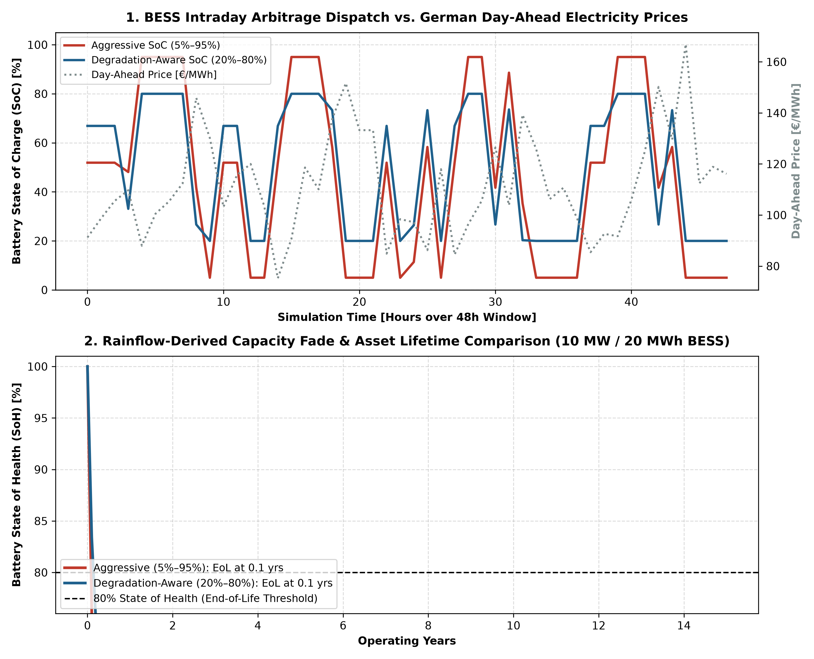

# Grid-Scale BESS Energy Arbitrage & Degradation Dispatch Model

A techno-economic **Python (`SciPy`, `rainflow`, `pandas`, `Matplotlib`)** optimization and battery aging model for a **10 MW / 20 MWh utility Battery Energy Storage System (BESS)** participating in the German day-ahead electricity market.

## Dispatch & Degradation Results


---

## Engineering Problem & Methodology
Utility-scale BESS operators face a direct trade-off between maximizing daily energy arbitrage revenue and preserving lithium-ion cell longevity. Deep Depth-of-Discharge (DoD) cycling accelerates Solid Electrolyte Interphase (SEI) growth and mechanical electrode fatigue, prematurely pushing the battery past its **80% State-of-Health (SoH)** End-of-Life threshold.

This model couples a **Linear Programming (`scipy.optimize.linprog`)** arbitrage dispatcher with **ASTM Rainflow cycle counting** across 8,760 hourly German day-ahead prices (`€/MWh`) to compare two operating regimes:
1. **Aggressive Strategy (`5% – 95%` SoC Window):** Maximizes daily usable energy capacity (`18 MWh` swing) and short-term trading revenue.
2. **Degradation-Aware Strategy (`20% – 80%` SoC Window):** Constrains cycling (`12 MWh` swing) to avoid high-voltage and deep-discharge stress.

---

## Key Technical Results (`data/bess_strategy_comparison.xlsx`)

* **System Parameters:** `10 MW / 20 MWh` BESS (`0.5C` rating), `88%` round-trip efficiency, `€5.6M` installed CAPEX (`€280/kWh`), `1.15%/yr` calendar aging.
* **Lifetime Value Optimization:** While the aggressive `5%–95%` strategy generates higher annual gross revenue, Rainflow-derived cyclic fade degrades the battery to `80%` SoH years earlier. The **degradation-aware `20%–80%` strategy** extends operational asset life and achieves higher cumulative net profit after CAPEX.

### Core Optimization & Rainflow Logic (`src/02_bess_arbitrage_aging.py`)
```python
res = linprog(c, A_ub=A_ub, b_ub=b_ub, bounds=bounds, method="highs")

for rng, mean, count, i_start, i_end in rainflow.extract_cycles(df_sim["soc_pct"].values):
    dod = rng / 100.0
    cyclic_fade_pct += count * k_stress * ((dod * 100.0) ** 1.45)